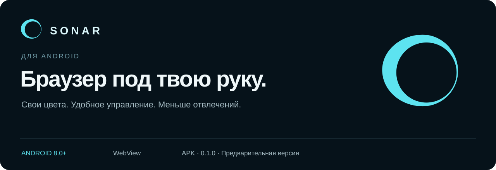
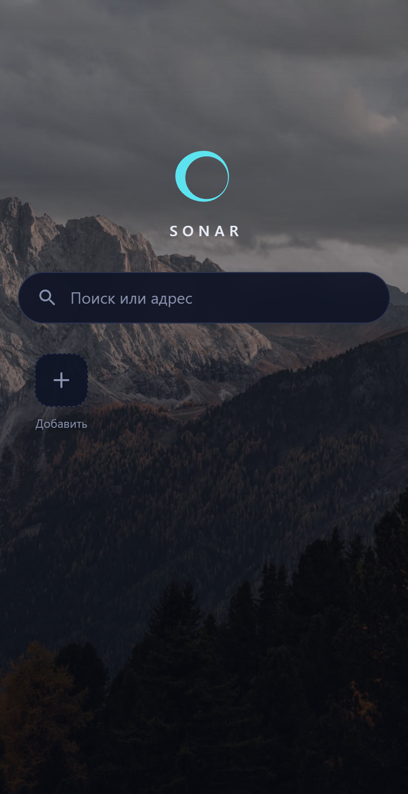
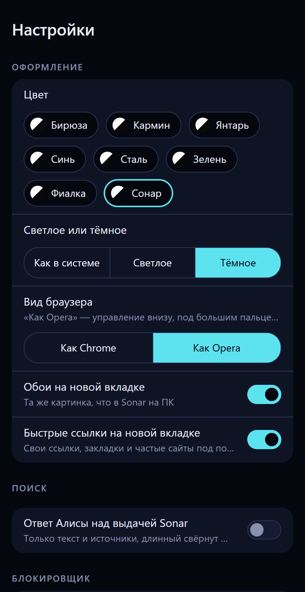

  

  <a href="https://github.com/erteterya/Sonar-android/releases/download/v0.1.0/Sonar-android-0.1.0.apk"><strong>Скачать APK</strong></a>
  &nbsp; · &nbsp;
  <a href="https://github.com/erteterya/Sonar-android/releases/tag/v0.1.0">Что нового в 0.1.0</a>
  &nbsp; · &nbsp;
  <a href="https://github.com/erteterya/Sonar-android/releases">Все выпуски</a>
  &nbsp; · &nbsp;
  <a href="https://github.com/erteterya/Sonar">Sonar для Windows</a>

Sonar — браузер для Android с настраиваемым управлением, цветами настольной версии, поиском Sonar и заметками Inner Voice. Страницы открываются на системном движке Android WebView.

**Android 8.0 и новее · Версия 0.1.0 · Предварительный выпуск**

В этом репозитории публикуются APK, описание и материалы приложения. Исходный код браузера здесь не размещён.

## Управление под твою руку

Выбери привычный вариант в **Настройки → Оформление → Вид браузера**.

| Как Chrome | Как Opera |
| :--- | :--- |
| Основное управление на верхней панели. | Адресная строка сверху, кнопки управления снизу — под большим пальцем. |
| Привычное расположение элементов браузера. | Меню открывается листом снизу. |

## Свои цвета и своя главная

Светлый, тёмный или системный режим, семейства цветов Sonar и обои. Быстрые ссылки можно добавлять, менять долгим нажатием и убирать. При желании блок быстрых ссылок скрывается целиком.

<table>
  <tr>
    <td align="center"></td>
    <td align="center"></td>
  </tr>
  <tr><td align="center">Новая вкладка</td><td align="center">Оформление и управление</td></tr>
</table>

Здесь показаны встроенные веб-страницы приложения, отрисованные из его файлов с тестовыми настройками. Системные панели Android и нативная панель браузера не входят в эти изображения.

## Что внутри

| Возможность | Как работает |
| :--- | :--- |
| **Поиск Sonar** | Свои закладки и история рядом с результатами Яндекса и DuckDuckGo; отдельные разделы картинок и видео. Доступность внешних источников зависит от сети. |
| **Меньше рекламы** | Блокировка рекламы и трекеров, обновляемые списки и выключатель для отдельного сайта. |
| **Меньше окон о cookie** | Скрытие плашек и автоматический отказ на поддерживаемых сайтах. |
| **Inner Voice** | Заметки себе с хранением на своём Google Диске и доступом с ПК после подключения аккаунта. |
| **Повседневные инструменты** | Вкладки карточками, закладки, история, поиск по странице, загрузки, версия сайта для ПК и полноэкранное видео. |

## Установить

1. Открой [выпуск 0.1.0](https://github.com/erteterya/Sonar-android/releases/tag/v0.1.0) на телефоне и скачай **Sonar-android-0.1.0.apk**.
2. Открой APK. Если Android попросит, разреши установку из приложения, которым открываешь файл.
3. Запусти Sonar и выбери оформление в настройках.

Предварительная версия находится в разделе [Releases](https://github.com/erteterya/Sonar-android/releases). Ссылка GitHub `releases/latest` не показывает предварительные выпуски.

**Если раньше была тестовая сборка:** выпуск подписан другим ключом и может не устанавливаться поверх неё. Перед удалением старой сборки сохрани нужные данные: удаление приложения стирает его локальные данные. Это относится к переходу с тестовой сборки, а не к каждому обновлению.

Контрольные суммы APK опубликованы рядом с файлом: [SHA256SUMS.txt](https://github.com/erteterya/Sonar-android/releases/download/v0.1.0/SHA256SUMS.txt).

## Обратная связь

[Сообщить об ошибке](https://github.com/erteterya/Sonar-android/issues/new) · [Предложить улучшение](https://github.com/erteterya/Sonar-android/issues)

Для отчёта укажи модель телефона, версию Android и Sonar, шаги повторения и ожидаемый результат. Если проблема связана с сайтом — добавь его адрес. Перед отправкой снимка убери личные данные.

---

**SONAR** · [Android](https://github.com/erteterya/Sonar-android) · [Windows](https://github.com/erteterya/Sonar)
